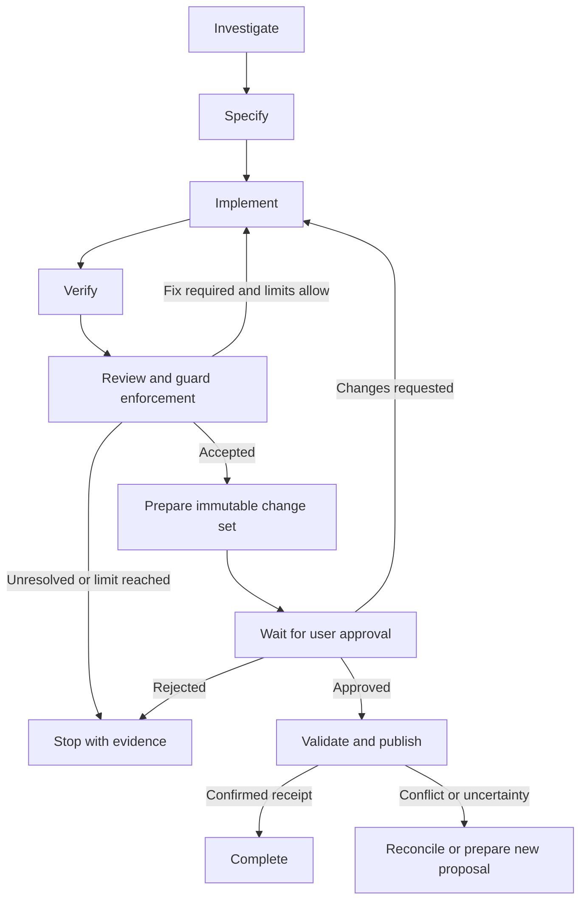

# State Machines and Coordinated Lifecycles

## 1. The Simple Explanation

A state machine describes which condition an object is in, which events it accepts, and which changes are valid. For example, a running task can complete, but a task that never started cannot truthfully report successful execution.

The workflow defines the process graph: investigate → specify → implement → verify → review, with explicit fix and publication branches. That does not mean all lifecycle behavior belongs inside a giant workflow class.

Each execution object owns a smaller lifecycle. The engine coordinates those objects through their public methods, policies decide applicable behavior, and repositories save validated state.

This page specifies proposed framework design. The state names and API examples below are an illustrative vocabulary to formalize during implementation, not existing code or a separate implementation task. Keep the published schema/version consistent once these contracts are implemented.

## 2. Two Different Meanings of State

| Kind | Question | Example |
| --- | --- | --- |
| Workflow position / process graph | Which assignment is next under this plan? | After accepted investigation, prepare the specification. |
| Object lifecycle | What can this particular execution legally do now? | A StepRun is active, waiting for retry, completed, or failed. |

WorkflowDefinition is immutable. It describes nodes, dependencies, and transition rules; it does not become “running” or store results. WorkflowRun is mutable per-request state and references the definition/version.

A useful runtime state contains more than one status string: run lifecycle, current step execution, completed result references, pending transition/command, counters, and child references. Do not represent that entire combination as hundreds of giant enum variants.

```text
Reusable workflow graph
          ↓ interpreted by WorkflowEngine
WorkflowRun for one request
  ├── StepRun(s), each with its own attempt history
  │     └── AgenticSession(s), when an executor needs a model/tool loop
  └── Publication, when the plan includes approved file application
```

These are coordinated lifecycles, not automatically one hierarchical state-machine engine. A small domain/state abstraction per responsibility is enough; use a general state-machine library only if the implementation benefits from it.

## 3. Ownership and File Placement

All paths below are relative to src/services/harness/workflow-framework/.

| Owner | Owns | Proposed location |
| --- | --- | --- |
| WorkflowDefinition / WorkflowBuilder | Valid process graph, step identities/dependencies, allowed transition definitions. | domain/WorkflowDefinition.ts; builder/WorkflowBuilder.ts |
| TransitionPolicy | Evidence-based next-step decision within the allowed graph and limits. | contracts/Policy.ts plus cohesive transition-policy implementations |
| WorkflowRun | Request lifecycle, step references, accepted results, pending coordination state, completion invariants. | domain/WorkflowRun.ts; domain/lifecycle/ |
| WorkflowEngine | Orchestration of accepted transitions, child execution, persistence, and recovery. | engine/WorkflowEngine.ts |
| StepRun | Lifecycle/outcomes for one execution of one StepDefinition; attempts and checkpoint references. | domain/StepRun.ts; domain/lifecycle/ |
| StepRunner / retry policies | Execution mechanics and permitted retries, not the whole workflow graph. | engine/StepRunner.ts; policies/ |
| AgenticSession | One loop invocation's lifecycle, conversation/protocol state, notebook revision, counters, and pending operations. | agentic/AgenticSession.ts; agentic/lifecycle/ |
| AgenticMindUnitRunner | Invokes model/tool collaborators and requests valid session state changes. | agentic/AgenticMindUnitRunner.ts |
| Publication | One immutable proposal/target pair's approval and application lifecycle, journal and receipt references. | workspaces/publication/Publication.ts; workspaces/publication/lifecycle/ |
| WorkspacePublisher | Preflight, approved application, journal reconciliation, and receipt coordination. | workspaces/publication/WorkspacePublisher.ts |
| Recovery coordinator and stores | Validated rehydration, leases/versioning, reconciliation and durable outcomes. | recovery/; contracts/; persistence/adapters/ and owning module adapters |

Publication is an explicit domain object proposed here to own state already required by the workspace design. WorkspaceHandle manages the working environment's separate lifecycle; “workspace exists” does not mean its changes are approved or published.

Each owning object protects transitions through domain methods or an injected/state-owned transition mechanism. A repository may reject stale versions but must not invent domain transitions. The UI is a projection, not a second authority for lifecycle state.

## 4. Workflow Graph: The Plan



This is an illustrative publication-inclusive plan. Existing five-step examples show its implementation segment. A build-only plan can complete with an explicitly unpublished proposal; publication-inclusive completion also requires a confirmed receipt.

The graph lists permitted branches. TransitionPolicy selects one based on actual results and configured constraints. WorkflowEngine validates the selected target/dependencies against the definition before scheduling it. A System 1 recommendation can supply evidence but cannot invent an unregistered step or override mandatory guards, budgets, or user approval.

Revisiting implementation creates a new StepRun under the same definition node. It does not mutate a completed previous StepRun back into running. Track the result revision selected for downstream input so verification/review refers to the correct change version rather than stale outputs.

## 5. WorkflowRun Lifecycle

Illustrative lifecycle states:

| State | Meaning | Example allowed next event |
| --- | --- | --- |
| created / queued | Request is recorded; execution is not active yet. | admit/start, reject, cancel-before-start. |
| active | Engine is coordinating permitted work. | accept child outcome, wait-for-approval, pause-at-checkpoint, stop/fail, complete when invariants hold. |
| waiting_for_approval | A durable exact proposal is awaiting a trusted decision. | record approval/rejection, request changes, expire under policy. |
| paused | Execution intentionally stopped at a recoverable boundary. | resume under current limits and valid state, cancel. |
| recovering | Interrupted/uncertain child or persistence work is being reconciled. | resume, remain blocked with reason, stop/fail, finish confirmed outcome. |
| completed | This plan's completion criteria and required durability conditions are met. | Read/export; no ordinary transition back to active. |
| failed | A terminal failure prevents completing this execution. | Read/export; a new run or explicitly modeled recovery process is separate. |
| stopped | Work ended without completion due to an explicit policy/limit/rejection outcome. | Read/export or an explicitly modeled continuation with preserved history. |
| cancelled | Cancellation has been reconciled according to the lifecycle contract. | Read/export; no automatic re-execution. |

The final implementation should specify which terminal outcomes permit a deliberate continuation, and how that continuation is identified/versioned. Never silently revive terminal work or reset its budgets.

Cancellation requested is an intent, not proof of cancellation completed. Persist the intent, signal children, and reconcile active external effects. Use nonterminal stopping/recovering state or explicit pending-operation metadata until the applicable completion conditions are known. Do not report “nothing changed” if a tool or publication may already have taken effect.

A run can be active while a child finishes, or waiting for approval while all coding children are completed. Completed children do not imply run completion. For a publication-inclusive plan, complete() requires the correct proposal's confirmed publication receipt and all configured verification/guard criteria.

## 6. StepRun and Attempt Lifecycles

StepDefinition describes an assignment. StepRun records one execution of it.

```text
pending → active → completed
              ├→ retry_wait → active (new attempt)
              ├→ interrupted → recovery decision
              ├→ failed
              └→ cancelled/stopped after reconciliation
```

An attempt has a unique ID and terminal outcome even when its parent StepRun will retry. A temporary transport error may be handled inside an agentic session rather than failing the whole step attempt; the configured retry ownership defines which layer records it. Do not count one underlying retry as three different new charges.

StepRunner coordinates input preparation, invocation, and execution policy. The engine/coordinator records accepted outcomes through StepRun/WorkflowRun methods and repositories. Define one persistence coordinator; do not let both independently mark the step completed.

A verification StepRun can complete successfully with result checksPassed=false. That means the check executed and returned useful evidence. TransitionPolicy may request a fix. It is different from failed because the test process could not start or a required result was unavailable.

Completed results are immutable execution history. A fix creates sr-implement-2 with a new assignment/result revision. Downstream verification uses that revision and earlier checks are not reused as proof of the new content.

## 7. AgenticSession Lifecycle and Internal Phases

A session is one invocation of AgenticMindUnit, not the agent's identity, the entire workflow, or a single model call.

Separate its main lifecycle from its current execution phase:

```text
Lifecycle:
  created → active → completed
                  ├→ interrupted → recovering → active or stopped/failed
                  ├→ stopped (budget/no-progress outcome)
                  ├→ failed
                  └→ cancelled after applicable reconciliation

Active phase examples:
  composing input → awaiting model → processing response
                                      ├→ invoking allowed tools → recording observations
                                      ├→ updating notebook
                                      └→ validating proposed final output
```

Active phases describe pending protocol work; they are not automatically parent run statuses. A notebook update or model response is not a successful session outcome by itself.

AgenticSession owns conversation/tool-call pairing, counters, notebook revision and pending-operation references. AgenticMindUnitRunner invokes the collaborators and requests domain state changes. Model actions are dispatched through registered action handlers, not a giant action-type behavior switch.

Completion requires a valid typed result and the configured completion policy. A schema-valid result can still need higher-level verification/review. Model/ToolRegistry permissions and budgets remain externally controlled.

A session may complete before the mapped step result has been persisted. If persistence then fails, preserve/reconcile the session's completed result reference rather than repeating tool side effects blindly.

Model selection is stable within a session. Escalation creates a new session with a ModelHandoff; the previous session retains its outcome. A checkpoint resume preserves session identity when valid, and never resets consumed budget or pending unknown charges.

## 8. Publication Lifecycle

Publication is keyed to a frozen proposal/version/digest and a designated target. Approved content cannot change in place.

```text
prepared → awaiting_approval
               ├→ rejected
               ├→ superseded (new proposal replaces it)
               └→ approved → preflight → applying → published
                                  ├→ conflicted
                                  └→ failed before application
                                               applying
                                                 └→ partial/uncertain
                                                       ↓
                                                   reconciling
                                                       ↓
                                    confirmed receipt, safe rollback,
                                    or unresolved partial outcome
```

Prepared means an immutable review bundle exists. Approved means the trusted approval covers that exact proposal/target; it does not mean files changed. Published means application has a verified durable receipt under the provider's guarantees. A lock, a model's statement, or an approved flag is insufficient proof.

Before applying, revalidate approval, source/check context, target fingerprints, and required reports. If the original changed, record a conflict. Resolving a conflict produces a new proposal, fresh applicable checks, and approval for that new version. Do not take a conflicted publication back to applying with different bytes under the old approval.

Changes requested/rejection leave the original unapplied. Later work creates a new proposal/publication identity. Retain history and explicit supersession links rather than deleting the prior approval record.

Cancellation during applying is special: some operations may already have succeeded. Stop new operations when possible, journal actual/unknown effects, and reconcile. Do not label the original workspace unchanged. A directory provider may have partial multi-file effects; atomic per-file rename does not make the whole publication atomic.

Rollback checks current fingerprints before restoring recorded before-state. It must not overwrite a user's edits made after partial application. The lifecycle needs an unresolved/reconciliation outcome when safe rollback cannot be established.

## 9. How Parent and Child States Coordinate

| Observation | What it permits | What it does not imply |
| --- | --- | --- |
| Session produced a completed result. | Executor can validate/map it into its task result. | Step result is durable, checks passed, or run completed. |
| Step result is accepted and durably saved. | Engine may select an allowed next transition. | All remaining steps completed. |
| Verification executed and returned failed checks. | Engine can request a bounded fix with evidence. | Verification infrastructure failed or implementation is accepted. |
| All implementation checks/reviews accepted. | Prepare a frozen review proposal. | User approved publication or original files changed. |
| Trusted approval is recorded. | Publisher may preflight the exact proposal. | Target is conflict-free or publication succeeded. |
| Publication has a confirmed receipt. | Publication-inclusive run may complete if other invariants hold. | Every optional memory/event subscriber succeeded. |
| Cancellation requested. | Prevent new work and request cooperative stopping. | Every external action stopped or was undone. |

Coordinate with typed commands and outcomes. A model can propose actions and report findings; only trusted/domain validated commands change authoritative lifecycle state. DecisionUnit/JEV/alternative recommendations do not grant approval or bypass completion rules.

## 10. OOP Transition Design

Each aggregate protects its invariant through a small public API, for example:

```typescript
// Illustrative domain commands, not a complete compilable implementation.
run.startStep(stepReference);
stepRun.startAttempt(attemptReference);
session.recordValidatedOutcome(outcomeReference);
stepRun.complete(resultReference);
run.recordStepResult(stepRun.reference);
run.waitForApproval(proposalReference);
publication.recordApproval(trustedApprovalReference);
publication.recordConfirmedReceipt(receiptReference);
run.complete(completionEvidence);
```

Dependencies are explicit: a publication cannot accept a receipt for another proposal; a run cannot complete from unverified model text; a StepRun cannot attach an outcome from another run without validation.

Use an immutable allowed-transition table plus invariant guards for simple lifecycle validation. Where states select genuinely different behavior, use small state/policy implementations behind a shared interface and registry, such as WaitingForApprovalState and ActiveRunState. Avoid a giant status switch in WorkflowEngine or separate copies of transition rules in UI/repositories/executors.

Not every label needs a class merely to hold its name. Plain enums/value objects and declarative transition data are appropriate when they do not hide behavior selection. Keep state-specific behavior cohesive, helpers private, and injected policies separate from storage/transport.

The graph, domain lifecycle rules, and policies must agree. Validate definition versions and dependencies before execution; validate lifecycle transitions at runtime. Reject invalid events with typed errors and safe evidence rather than silently coercing state.

## 11. Persistence, Concurrency, and Crash Recovery

Persist status, aggregate version, definition/version reference, child IDs, result/proposal references, pending command/outcome IDs, limits/deadline references, and operation identities. Snapshots are data; rehydration validates them and recreates injected live collaborators.

Use optimistic concurrency/compare-and-set or an equivalent explicit mechanism so two workers cannot independently advance the same version. Scoped ownership/lease checks control active execution. Stable command/event IDs make duplicate approval messages, child completion, retries, and publication requests idempotent.

Across aggregate/store boundaries, do not assume one in-memory method sequence is atomic. Use a durable coordination record, outbox, or equivalent pattern: save the intent/outcome reference, dispatch with an operation ID, accept the child result once, and reconcile pending work after restart. Never keep a database transaction open around model/tool calls or approval waiting.

Persist required state/event records atomically where possible or with a documented durable boundary. Debug subscriber delivery does not decide whether domain state changed. Optional memory write failure can be retried independently without pretending the completed code/publication failed retroactively.

On recovery, inspect persisted evidence, not a guessed status based on the last visible log line. Examples:

- Child completed, parent result missing: recover/validate the saved outcome and record it once instead of rerunning edits.
- Model/tool call has no durable outcome: retain uncertainty, restore protocol, and reconcile before side-effect replay.
- Approval was recorded but worker crashed: revalidate the same proposal/target and journal before application.
- Publication was partly applied: reconcile the journal/target fingerprints; do not rerun the full proposal blindly.

Budget reservations, no-progress history, deadlines, and unknown usage survive all of these transitions. Pausing/waiting does not silently renew an absolute expiry.

## 12. Worked Example A: Ordinary Google-Login Success

| Moment | Run | Step execution / session | Publication |
| --- | --- | --- | --- |
| Request admitted | active | Investigation pending. | None yet. |
| Investigation underway | active | sr-investigate-1 active; session-investigate-1 active. | None. |
| Findings saved | active | Investigation completed; its session completed; specification selected. | None. |
| Coding underway | active | sr-implement-1 active; isolated coding session and workspace. | None. |
| Checks/review accepted | active | Verification/review completed with accepted evidence. | Prepared for frozen changes-42/v1. |
| Review bundle presented | waiting_for_approval | Coding children remain completed. | awaiting_approval. |
| User approves exact proposal | active when publisher starts | No coding session needs to restart. | approved → preflight → applying. |
| Approved files verified/saved | completed after invariants/durability | Accepted child history remains immutable. | published with receipt-42. |

The application original remains unchanged during coding. A completed session is not publication. A publication-inclusive run stays non-completed until approval and confirmed application succeed.

## 13. Worked Example B: Verification Finds a Problem

1. sr-implement-1 completes and its session result is saved.
2. sr-verify-1 completes with checksPassed=false and evidence of a fixture callback mismatch.
3. Run remains active. TransitionPolicy selects a permitted fix under the current counters/budget.
4. The engine creates sr-implement-2 with the failed criterion and evidence. It does not reopen sr-implement-1.
5. A new coding session or explicit model escalation handoff performs the fix. The old session's history remains separate.
6. sr-verify-2 checks the corrected artifact revision and review follows with the right result references.
7. If fix limits are reached, stop with remaining issues rather than marking the workflow completed.

This separates a valid negative business result, a technical execution failure, and the process decision that follows it.

## 14. Worked Example C: Crash During Editing

1. Run and StepRun are active. AgenticSession has a checkpoint and a pending write operation ID.
2. The process stops after the write may have reached the isolated workspace but before outcome persistence.
3. No code claims a terminal cancellation or success merely because the process disappeared. Recovery marks/reconstructs interrupted work and checks the ledger/checkpoint/journal.
4. The recovery policy inspects the workspace or uses a tool idempotency contract to determine what occurred.
5. Recreate live capabilities and resume the same session when valid, or start an explicitly linked handoff with preserved state/evidence.
6. The parent StepRun continues or returns an honest stopped/failed outcome. Its original workflow budget is retained.

An open debug span explains missing completion; it does not prove the write never occurred.

## 15. Worked Example D: Approval, Conflict, and Reapproval

1. Run waits for approval of proposal changes-42/v1; publication pub-1 is awaiting_approval.
2. The user approves v1. Publication becomes approved, but files have not yet changed.
3. Preflight finds that the user edited auth/login.ts in the original since the baseline. Publication becomes conflicted; do not apply the stale proposal.
4. A conflict-resolution workflow produces changes-42/v2 with fresh checks. pub-1 remains historical; pub-2 references v2 and supersession lineage.
5. The run waits for approval of v2. Approval for v1 does not authorize v2.
6. After trusted v2 approval, preflight and application succeed. Its receipt permits completion under the plan.

If publication instead partially applied before a crash, the run remains explicitly non-completed/recovering until actual effects are reconciled. A replacement proposal does not erase those effects or its journal.

## 16. Debugging and First-Version Checks

Every lifecycle transition should record aggregate type/ID/version, event/command ID, previous/next state, reason/policy, definition/source/proposal references, causation, actor where appropriate, and correlation IDs. Validate and sanitize these typed events through the existing debug subsystem.

Show rejected transitions distinctly from accepted transitions. Persist intent versus confirmed effects distinctly, especially approval, external tools, and publication. A formatter can project a simple progress list while a detailed timeline retains attempts, sessions, waiting, uncertainty, and recovery.

First-version tests should cover valid/invalid transitions, immutable shared definitions, failed checks as valid results, retry versus fix identity, cancellation before and during side effects, child/parent persistence gaps, stale-worker concurrency, duplicate outcomes/approvals, expired limits on resume, forged/stale approval, changed proposals, publication conflicts/partial recovery, and completion invariants for build-only versus publication-inclusive workflows.

Keep transition rules in their owning domain/state modules and coordinate through the engine/publisher rather than introducing a second competing lifecycle authority. Tests inspect public behavior and persisted outcomes, not private state methods.

[OOP Architecture](08-oop-architecture-and-design-rules.md) · [Workspaces and Publication](21-isolated-workspaces-review-and-publication.md) · [Limits](18-limits-budgets-and-execution-control.md) · [Complete Walkthrough](17-google-login-complete-walkthrough.md) · [Back to table of contents](harness-workflows-executors-framework-idea.md)

## Transition Policies Use the Shared Contract

TransitionPolicy names an implementation of Policy<TransitionInput, TransitionDecision>, imported from the shared contracts/Policy.ts. WorkflowEngine awaits transitionPolicy.apply(input), validates the returned target against the graph, dependencies, and limits, then asks domain objects to record valid changes. Step input preparation uses Policy<TContext, TInput>. Runtime lifecycle invariants remain in WorkflowRun, StepRun, and session/publication owners; they are not optional interchangeable policies.

See [One Shared Policy Concept](31-shared-policy-concept.md) for the common contract, object setup, and recovery rules.

